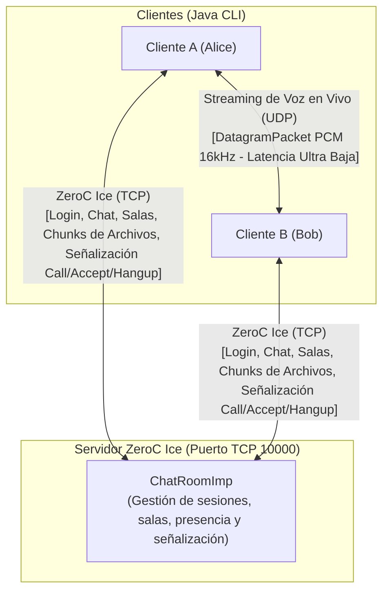

# Plataforma Distribuida de Chat Multimedia y Streaming de Voz sobre ZeroC Ice y Datagramas UDP
**Universidad Icesi**  
**Facultad de Ingeniería, Diseño y Ciencias Aplicadas**  
**Departamento de Computación y Sistemas Inteligentes**  
**Curso:** Computación en Internet I (09810 - TIC)  
**Taller Evaluativo Unidad 2:** Sistemas Distribuidos, Middleware y Comunicación Multimedia  
---
## 1. Descripción del Proyecto y Arquitectura Híbrida
El sistema es una plataforma de comunicación distribuida en tiempo real (arquitectura similar a Discord o Slack) construida bajo una **arquitectura de red híbrida**:
1. **Canal de Control, Mensajería y Archivos (ZeroC Ice sobre TCP):**
   * Tipado estricto definido mediante contratos Slice (`.ice`).
   * Despacho asíncrono con `CompletableFuture` y proxies fijos para callbacks bidireccionales.
   * Gestión de presencia en tiempo real, chat privado (1 a 1), salas grupales y transferencia binaria de archivos fragmentados en bloques (chunking de 32 KB).
2. **Canal de Streaming de Voz en Tiempo Real (Sockets UDP crudos):**
   * Streaming de baja latencia sin la sobrecarga ni el bloqueo de retransmisiones de TCP.
   * Muestreo PCM a 16 kHz, 16 bits, Mono con la API `javax.sound.sampled` de Java.
   * Empaquetamiento en tramas de 20 ms (640 bytes) transmitidas mediante `DatagramPacket` y `DatagramSocket`.
   * Soporte de llamadas directas 1 a 1 y conferencias grupales mediante **Malla Peer-to-Peer (Mesh)**.

---
## 2. Estructura Multimodular del Proyecto (Gradle)
```text
taller-chat/
├── common/                               # Contratos Slice y stubs generados
│   ├── src/main/slice/Chat.ice           # Definición de interfaces, structs y excepciones
│   └── build.gradle                      # Tarea slice2java
├── server/                               # Lógica central del servidor Ice
│   ├── src/main/java/comp1/chat/server/
│   │   ├── ChatRoomImp.java              # Implementación thread-safe del servant
│   │   └── ServerMain.java               # Inicialización del adaptador Ice (puerto 10000)
│   ├── src/test/java/comp1/chat/
│   │   └── VoiceCallIntegrationTest.java # Pruebas automatizadas de llamadas y conferencias
│   └── build.gradle
├── client/                               # Cliente de consola interactivo y motor de audio
│   ├── src/main/java/comp1/chat/client/
│   │   ├── ClientMain.java               # CLI interactiva desacoplada
│   │   ├── audio/                        # Subsistema de voz sobre UDP
│   │   │   ├── AudioConfig.java          # Configuración PCM (16 kHz, 640 B / 20 ms)
│   │   │   ├── AudioSender.java          # Captura (TargetDataLine) y envío UDP (DatagramPacket)
│   │   │   ├── AudioReceiver.java        # Recepción UDP y reproducción (SourceDataLine)
│   │   │   └── VoiceCallManager.java     # Máquina de estados de llamadas y detección de IP
│   │   ├── callback/
│   │   │   └── ClientCallbackImpl.java   # Despacho de eventos asíncronos desde el servidor
│   │   └── transfer/
│   │       └── FileTransferManager.java  # Chunking (32 KB) y reconstrucción en disco
│   └── build.gradle
├── llamadas.md                           # Guía técnica específica de VoIP y pruebas LAN
├── README.md                             # Este documento técnico
├── settings.gradle
└── build.gradle                          # Tareas raíz runServer y runClient
```
---
## 3. Estado Actual de la Implementación (Fase del Proyecto)
El proyecto se encuentra en la **Fase 3: Completitud Funcional y Pruebas Superadas (100% de los RFs implementados)**.
| Requerimiento | Descripción | Estado |
| :--- | :--- | :---: |
| **RF-01** | Sesión, presencia reactiva, nick único y desconexión tolerante a fallos (ACM) | **100% Completo** |
| **RF-02** | Mensajería privada 1 a 1 asíncrona con confirmación y control de errores | **100% Completo** |
| **RF-03** | Creación y administración dinámica de salas, broadcast sin eco y aislamiento | **100% Completo** |
| **RF-04** | Transferencia multimedia sobre Ice con chunking (32 KB) y guardado en `downloads/` | **100% Completo** |
| **RF-05** | Llamadas de voz directas 1 a 1 (Señalización Ice + Streaming de audio UDP + Mute/Hangup) | **100% Completo** |
