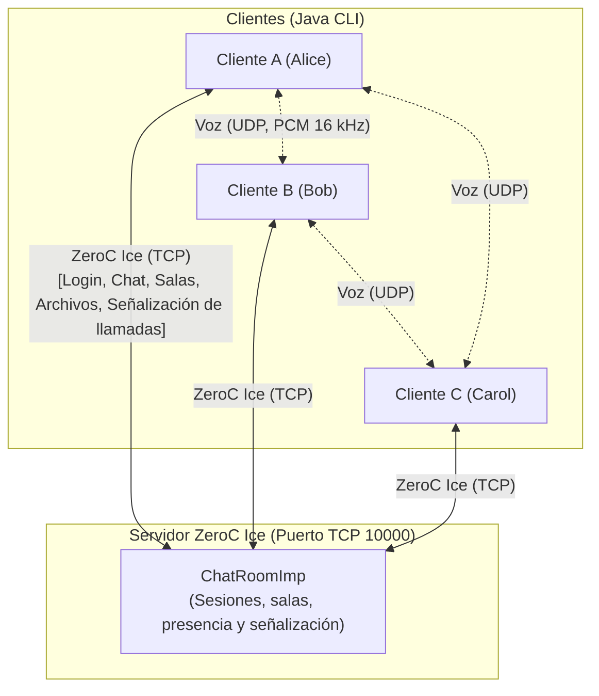

# Plataforma Distribuida de Chat Multimedia y Streaming de Voz sobre ZeroC Ice y Datagramas UDP
**Universidad Icesi**  
**Facultad de Ingeniería, Diseño y Ciencias Aplicadas**  
**Departamento de Computación y Sistemas Inteligentes**  
**Curso:** Computación en Internet I (09810 - TIC)  
**Taller Evaluativo Unidad 2:** Sistemas Distribuidos, Middleware y Comunicación Multimedia  

---

# **Autores:**
-  Daniel Montenegro / A00409572
-  Jose Daniel Cordoba / A00407856
-  Santiago Gomez Lopez / A00403929
-  Jonathan David Cortes Castaño / A00411095


---

## Contenido
1. [Descripción y arquitectura](#1-descripción-del-proyecto-y-arquitectura-híbrida)
2. [Estructura del proyecto](#2-estructura-multimodular-del-proyecto-gradle)
3. [Estado de la implementación](#3-estado-actual-de-la-implementación)
4. [Requisitos y puesta en marcha](#4-requisitos-y-puesta-en-marcha)
5. [Uso de la aplicación](#5-uso-de-la-aplicación)
6. [Llamadas de voz (1 a 1 y grupales)](#6-llamadas-de-voz-1-a-1-y-grupales)
7. [Cómo probarlo entre varios computadores (LAN)](#7-cómo-probarlo-entre-varios-computadores-lan--wi-fi)
8. [Pruebas automatizadas](#8-pruebas-automatizadas)
9. [Limitaciones conocidas](#9-limitaciones-conocidas)
10. [Flujo de trabajo con Git](#10-flujo-de-trabajo-con-git)

---

## 1. Descripción del Proyecto y Arquitectura Híbrida
El sistema es una plataforma de comunicación distribuida en tiempo real (arquitectura similar a Discord o Slack) construida bajo una **arquitectura de red híbrida**:
1. **Canal de Control, Mensajería y Archivos (ZeroC Ice sobre TCP):**
   * Tipado estricto definido mediante contratos Slice (`.ice`).
   * Callbacks bidireccionales: el cliente expone un `ClientCallback` y el servidor lo invoca de forma asíncrona (mensajes, presencia, archivos, señalización de llamadas).
   * Gestión de presencia en tiempo real, chat privado (1 a 1), salas grupales y transferencia binaria de archivos fragmentados en bloques (chunking de 32 KB).
2. **Canal de Streaming de Voz en Tiempo Real (Sockets UDP crudos):**
   * Streaming de baja latencia sin la sobrecarga ni el bloqueo de retransmisiones de TCP.
   * Muestreo PCM a 16 kHz, 16 bits, Mono con la API `javax.sound.sampled` de Java.
   * Empaquetamiento en tramas de 20 ms (640 bytes de audio + 4 bytes de número de secuencia) transmitidas mediante `DatagramPacket` y `DatagramSocket`.
   * Soporte de llamadas directas 1 a 1 y conferencias grupales mediante **Malla Peer-to-Peer (Mesh)**, con mezcla y sincronización de las distintas fuentes en el receptor.

El servidor **solo hace de señalización** (quién está en qué llamada y en qué IP:puerto UDP). El audio viaja directamente entre los clientes; el servidor nunca lo procesa.



---

## 2. Estructura Multimodular del Proyecto (Gradle)
```text
taller-chat/
├── common/                               # Contratos Slice y stubs generados
│   ├── src/main/slice/Chat.ice           # Definición de interfaces, structs y excepciones (módulo ChatApp)
│   └── build.gradle                      # Tarea slice2java
├── server/                               # Lógica central del servidor Ice
│   ├── src/main/java/comp1/chat/server/
│   │   ├── ChatRoomImp.java              # Implementación thread-safe del servant
│   │   └── ServerMain.java               # Inicialización del adaptador Ice (puerto 10000)
│   ├── src/test/java/comp1/chat/
│   │   └── VoiceCallIntegrationTest.java # Pruebas de señalización de llamadas y conferencias
│   └── build.gradle
├── client/                               # Cliente de consola interactivo y motor de audio
│   ├── src/main/java/comp1/chat/client/
│   │   ├── ClientMain.java               # CLI interactiva (comandos /login, /msg, /call, ...)
│   │   ├── audio/                        # Subsistema de voz sobre UDP
│   │   │   ├── AudioConfig.java          # Formato PCM y constantes del protocolo de audio
│   │   │   ├── AudioSender.java          # Captura (TargetDataLine), numera frames y envía a todos los pares
│   │   │   ├── AudioReceiver.java        # Recibe de todos los pares, separa fuentes y reproduce la mezcla
│   │   │   ├── JitterBuffer.java         # Buffer por fuente: reordena, tapa pérdidas, limita latencia
│   │   │   ├── AudioMixer.java           # Suma de muestras PCM con saturación
│   │   │   └── VoiceCallManager.java     # Máquina de estados de llamadas, malla de pares y detección de IP
│   │   ├── callback/
│   │   │   └── ClientCallbackImpl.java   # Despacho de eventos asíncronos desde el servidor
│   │   └── transfer/
│   │       └── FileTransferManager.java  # Chunking (32 KB) y reconstrucción en disco
│   ├── src/test/java/comp1/chat/client/audio/
│   │   ├── JitterBufferTest.java         # Reordenamiento, pérdida, llegada tardía, underrun, reinicio
│   │   ├── AudioMixerTest.java           # Suma y saturación
│   │   └── GroupAudioMixTest.java        # 3 emisores por UDP real -> un solo flujo mezclado
│   └── build.gradle
├── llamadas.md                           # Guía técnica extendida de VoIP (el resumen está en la sección 6)
├── README.md                             # Este documento
├── settings.gradle
└── build.gradle                          # Tareas raíz runServer, runClient y packageJars
```

---

## 3. Estado Actual de la Implementación
Todos los requerimientos funcionales están implementados.

| Requerimiento | Descripción | Estado |
| :--- | :--- | :---: |
| **RF-01** | Sesión, presencia reactiva, nick único y desconexión tolerante a fallos (ACM) | **Completo** |
| **RF-02** | Mensajería privada 1 a 1 asíncrona con confirmación y control de errores | **Completo** |
| **RF-03** | Creación y administración dinámica de salas, broadcast sin eco y aislamiento | **Completo** |
| **RF-04** | Transferencia multimedia sobre Ice con chunking (32 KB) y guardado en `downloads/` | **Completo** |
| **RF-05** | Llamadas de voz directas 1 a 1 (señalización Ice + streaming UDP + Mute/Hangup) | **Completo** |
| **RF-06** | Llamadas de voz grupales por sala (malla P2P) con mezcla y sincronización de varias fuentes de audio | **Completo** |

---

## 4. Requisitos y puesta en marcha

### Requisitos
* **JDK 17** (el proyecto compila con `sourceCompatibility = 17`).
* **ZeroC Ice 3.7** instalado, con el compilador **`slice2java` disponible en el `PATH`**: el módulo `common` lo invoca para generar los stubs a partir de `Chat.ice`. La librería de ejecución (`com.zeroc:ice:3.7.11`) se descarga sola con Gradle.
* Para voz: micrófono y altavoces/auriculares. Si no hay dispositivo, el cliente funciona igual y avisa por consola (`[AUDIO-TX]` / `[AUDIO-RX]`). **Usa auriculares** para evitar que el micrófono capte los altavoces (eco).

### Compilar y ejecutar
Desde la raíz del proyecto:
```bash
./gradlew build          # compila todo y ejecuta las pruebas
./gradlew runServer      # inicia el servidor (TCP 10000)
./gradlew runClient      # inicia un cliente (una terminal por usuario)
```
En Windows PowerShell usa `.\gradlew.bat` en lugar de `./gradlew`.

El cliente pregunta `IP del servidor Ice (Enter para 127.0.0.1):`. También puedes pasarla directamente:
```bash
./gradlew runClient --args="192.168.1.15"          # IP del servidor
./gradlew runClient --args="192.168.1.15 10000"    # IP y puerto
```

### Generar los JAR ejecutables (para llevarlos a otras máquinas)
```bash
./gradlew packageJars
```
Crea en `build/dist/`:

| Archivo | Contenido |
| :--- | :--- |
| `chat-server.jar` | Servidor (`Main-Class: comp1.chat.server.ServerMain`) |
| `chat-client.jar` | Cliente (`Main-Class: comp1.chat.client.ClientMain`) |

Son **autocontenidos**: incluyen el runtime de Ice y las clases de `common`, con el `Main-Class` y los datos de versión en su `MANIFEST.MF`. En la máquina destino **solo hace falta un JRE/JDK 17**; no se necesitan Gradle, Ice ni el código fuente.
```bash
java -jar chat-server.jar                       # servidor (TCP 10000)
java -jar chat-client.jar                       # cliente; pregunta la IP del servidor
java -jar chat-client.jar 192.168.1.15          # cliente con IP del servidor
java -jar chat-client.jar 192.168.1.15 10000    # IP y puerto
```
Los archivos recibidos se guardan en `downloads/` dentro de la carpeta desde la que ejecutes el cliente.

---

## 5. Uso de la aplicación

### Inicio rápido (todo en una misma máquina)
1. Terminal 1: `./gradlew runServer`
2. Terminal 2: `./gradlew runClient` → Enter → `/login alice`
3. Terminal 3: `./gradlew runClient` → Enter → `/login bob`
4. En la terminal de alice: `/msg bob hola` → bob lo recibe al instante.

Mientras otros usuarios entran o salen, verás avisos como `[PRESENCIA] El usuario 'alice' se ha CONECTADO.`

> Reglas de nombres: nicknames de 1 a 20 caracteres (`A-Z a-z 0-9 _ . -`) y únicos; las salas de 1 a 20 caracteres (`A-Z a-z 0-9 _ -`). Los errores del servidor se muestran con su motivo, por ejemplo `[ERROR] User 'nadie' does not exist or is disconnected`.

### Sesión y presencia
| Comando | Acción |
| :--- | :--- |
| `/login <nick>` | Inicia sesión; muestra los usuarios ya conectados |
| `/logout` | Cierra sesión |
| `/users` | Lista los usuarios conectados |
| `/status` | Usuario, sala activa, estado de voz, mute, endpoint UDP local y número de fuentes de audio activas |
| `/help` | Menú de ayuda |
| `/quit` | Sale de llamadas/salas de voz, cierra sesión y termina el cliente |

### Mensajes privados
| Comando | Acción |
| :--- | :--- |
| `/msg <usuario> <texto>` | Mensaje privado a un usuario conectado |

### Salas de chat
| Comando | Acción |
| :--- | :--- |
| `/rooms` | Lista las salas existentes |
| `/create <sala>` | Crea una sala, entra en ella y la deja como **sala activa** |
| `/join <sala>` | Entra a una sala existente (queda como sala activa) |
| `/leave [sala]` | Sale de una sala (por defecto la activa) |
| `/send <texto>` | Envía el texto a la sala activa |
| `/send <sala> <texto>` | Envía a una sala concreta **de la que seas miembro** |

Si el primer texto tras `/send` coincide con una sala a la que perteneces se toma como destino; de lo contrario todo el mensaje va a la sala activa. Los mensajes de sala no se te devuelven a ti mismo (sin eco).

### Transferencia de archivos
```
/sendfile <usuario> <ruta_del_archivo>
/sendfile #<sala> <ruta_del_archivo>
```
El archivo se divide en fragmentos de 32 KB que viajan por Ice y se reensamblan en el destino. Cada receptor lo guarda en la carpeta **`downloads/`** (relativa al directorio donde se ejecutó el cliente). Ejemplos: `/sendfile bob informe.pdf`, `/sendfile #general foto.png`.

---

## 6. Llamadas de voz (1 a 1 y grupales)

### 6.1 ¿Por qué es una "llamada" sin red telefónica?
Es **VoIP** (el mismo principio de Discord, Zoom o WhatsApp): la voz se digitaliza y viaja en paquetes por la red de datos.

```
+----------------------------------------------------------------------------------+
|                      CANAL DE CONTROL (ZeroC Ice / TCP)                          |
|  Alice --["¿Aceptas? Mi endpoint UDP es 192.168.1.15:52341"]--> servidor --> Bob |
|  Bob   --["Acepto. Mi endpoint UDP es 192.168.1.20:58122"]----> servidor --> Alice
+----------------------------------------------------------------------------------+
                                       |
                                       v
+----------------------------------------------------------------------------------+
|                    CANAL DE AUDIO EN VIVO (datagramas UDP, P2P)                  |
|  Micrófono Alice -> PCM -> DatagramPacket ------------------> Altavoces Bob      |
|  Micrófono Bob   -> PCM -> DatagramPacket ------------------> Altavoces Alice    |
+----------------------------------------------------------------------------------+
```

1. **Captura y muestreo:** `TargetDataLine` digitaliza el micrófono en PCM de **16 kHz, 16 bits, mono**.
2. **Framing:** cada **20 ms** se toman 640 bytes (`16000 muestras/s × 2 bytes × 0,02 s`).
3. **Transporte:** el frame se envía en un datagrama UDP a la IP:puerto de cada interlocutor.
4. **¿Por qué UDP y no TCP?** TCP retransmitiría paquetes perdidos y detendría el flujo hasta confirmarlos, acumulando retraso. En voz en vivo es preferible descartar un frame de 20 ms perdido y seguir, manteniendo latencia mínima.
5. **Reproducción:** el receptor entrega el audio a los altavoces con `SourceDataLine`.

Cada cliente abre **un único socket UDP** (puerto efímero asignado por el SO) que sirve para enviar y recibir todo su audio. Ese endpoint se comunica a los demás mediante Ice (`startCall`, `acceptCall`, `joinVoiceRoom`).

### 6.2 Llamada directa 1 a 1 (RF-05)
| Comando | Acción |
| :--- | :--- |
| `/call <usuario>` | Llama a un usuario conectado (queda en estado `CALLING`) |
| `/accept` | Contesta la llamada entrante (el otro lado ve `[LLAMADA ENTRANTE] ...`) |
| `/reject [motivo]` | Rechaza la llamada entrante |
| `/hangup` | Cuelga; el otro extremo es avisado y libera su audio |
| `/mute` / `/unmute` | Deja de enviar / vuelve a enviar tu micrófono sin colgar |

Flujo de señalización: `startCall` → `onIncomingCall` (timbra en el destino) → `acceptCall` → `onCallAccepted` (el llamante recibe el endpoint del destino) → ambos empiezan a enviarse audio UDP. `rejectCall` → `onCallRejected`; `endCall` → `onCallEnded`.

Estados del cliente (`/status`): `IDLE`, `CALLING`, `RINGING`, `IN_CALL`, `IN_VOICE_ROOM`. Solo se puede tener una llamada o conferencia a la vez.

### 6.3 Llamada grupal por sala (RF-06)
| Comando | Acción |
| :--- | :--- |
| `/vjoin [sala]` | Entra a la conferencia de voz de la sala (por defecto, la sala activa) |
| `/vleave` | Sale de la conferencia |
| `/mute` / `/unmute` | Silencia / activa tu micrófono |

**Para entrar a la voz de una sala primero debes ser miembro de ella** (`/create` o `/join`), y después `/vjoin`.

Ejemplo con tres personas:
```
alice> /create general        bob> /join general        carol> /join general
alice> /vjoin general         bob> /vjoin general        carol> /vjoin general
```
Funcionamiento (**malla P2P / mesh**):
* `joinVoiceRoom` devuelve al que entra la lista de IP:puerto de quienes ya están en la conferencia, y el servidor avisa a esos participantes con `onVoiceRoomJoined`.
* Cada cliente envía una copia de cada frame de su micrófono a **todos** los demás participantes; el servidor no procesa audio.
* Cuando alguien sale (`/vleave`, `/logout` o caída de conexión) los demás reciben `onVoiceRoomLeft` y dejan de enviarle.

### 6.4 Mezcla y sincronización de varias fuentes de audio
Cuando varias personas hablan a la vez, sus paquetes llegan intercalados por el mismo socket. Reproducirlos tal cual produciría ruido, así que `AudioReceiver` hace lo siguiente:

```
 socket UDP ─► [hilo RX] ─► separa por dirección del emisor
                              ├─ JitterBuffer(Alice) ─┐
                              ├─ JitterBuffer(Bob)   ─┼─► [hilo Mixer, reloj de 20 ms] ─► suma ─► altavoz
                              └─ JitterBuffer(Carol) ─┘
```
1. **Numeración:** cada datagrama es `[secuencia int32][640 bytes PCM]`. `AudioSender` incrementa la secuencia por cada frame enviado (no avanza mientras estás en mute, así no se generan huecos).
2. **Una fuente = un buffer de jitter (`JitterBuffer`):**
   * reordena los frames por secuencia;
   * descarta los que llegan tarde;
   * sustituye un frame perdido por **silencio**, para no desplazar esa voz respecto a las demás;
   * espera un colchón de **60 ms** antes de empezar y limita el retraso acumulado a **200 ms** (descarta los más viejos);
   * si el emisor reinicia su contador (nueva llamada), el buffer se reinicia solo.
3. **Un único reloj de 20 ms** (hilo mezclador) toma un frame de cada fuente activa, los suma muestra a muestra con saturación (`AudioMixer`, sin desbordar) y escribe un solo flujo al altavoz. Ese reloj común es lo que mantiene sincronizadas las voces.
4. Si la tarjeta de sonido acumula más de 80 ms, el mezclador espera para no aumentar la latencia.
5. Las fuentes que dejan de transmitir más de 1 s se eliminan solas. `/status` muestra cuántas fuentes están activas (`Fuentes audio`).

Parámetros ajustables en `AudioConfig`: `JITTER_PREFILL_FRAMES`, `MAX_BUFFER_FRAMES`, `SOURCE_IDLE_TIMEOUT_MS`, `MAX_SPEAKER_QUEUE_FRAMES`.

---

## 7. Cómo probarlo entre varios computadores (LAN / Wi-Fi)
Para probar entre dos o más equipos conectados al mismo Wi-Fi o router:

### Paso 1: IP del equipo servidor
En el equipo del **servidor (PC 1)** ejecuta `ipconfig` y copia la **Dirección IPv4** de tu adaptador Wi-Fi/Ethernet (ejemplo: `192.168.1.15`).

### Paso 2: Permitir puertos en el Firewall de Windows (PC del servidor)
En PowerShell como Administrador:
```powershell
New-NetFirewallRule -DisplayName "Taller Chat Ice TCP" -Direction Inbound -LocalPort 10000 -Protocol TCP -Action Allow
New-NetFirewallRule -DisplayName "Taller Chat Audio UDP" -Direction Inbound -Protocol UDP -Action Allow
```
*(O permite Java cuando aparezca la ventana emergente del Firewall.)* **Todos los equipos que hagan llamadas** deben permitir UDP entrante, porque el audio llega directamente de un cliente a otro, no pasa por el servidor.

### Paso 3: Servidor (PC 1)
```bash
./gradlew runServer
```
*(O, sin Gradle: `java -jar chat-server.jar`.)*

### Paso 4: Clientes (uno por equipo)
```bash
./gradlew runClient
```
*(O, en equipos sin el proyecto: copia `build/dist/chat-client.jar` —generado con `./gradlew packageJars`— y ejecuta `java -jar chat-client.jar`; solo necesita Java 17.)*
* En la PC 1 pulsa **Enter** a la pregunta de la IP; en las demás escribe la IP de la PC 1 (`192.168.1.15`).
* Cada uno inicia sesión con un nombre distinto: `/login daniel`, `/login santiago`, ...

### Paso 5: Probar la llamada 1 a 1
1. `daniel`: `/call santiago`
2. `santiago` verá `[LLAMADA ENTRANTE] *** De: 'daniel' (IP: ..., Puerto UDP: ...) ***` y responde `/accept`.
3. Hablen: cada uno oye al otro. Prueben `/mute`, `/unmute` y `/hangup`.

### Paso 6: Probar la conferencia grupal (3 o más equipos)
1. Uno crea la sala (`/create general`) y los demás se unen (`/join general`).
2. Todos ejecutan `/vjoin general`.
3. Hablen **a la vez**: cada participante debe oír a todos los demás mezclados. `/status` debe mostrar `Fuentes audio: N-1`.
4. Salgan con `/vleave`.

> Si el audio no llega: revisa el firewall (UDP) y que el endpoint mostrado en `/status` sea la IP de la red local (no `127.0.0.1`). Si el servidor corre en otra máquina, el cliente detecta su IP según la interfaz que usa para llegar a él.

---

## 8. Pruebas automatizadas
```bash
./gradlew test                 # todas
./gradlew :client:test         # audio: jitter, mezcla y mezcla multi-fuente por UDP
./gradlew :server:test         # señalización de llamadas y conferencias
```
* `JitterBufferTest`: colchón inicial, reordenamiento, frame perdido → silencio, llegada tardía, underrun, desbordamiento y reinicio del emisor.
* `AudioMixerTest`: suma de muestras y saturación.
* `GroupAudioMixTest`: tres emisores reales por UDP hacia un receptor; verifica que sale la suma de las tres voces y nunca frames de distintas fuentes intercalados.

Las pruebas de audio no necesitan micrófono ni altavoces.

---

## 9. Limitaciones conocidas
* **Ancho de banda de la malla:** cada cliente envía una copia de su audio por participante, así que el consumo crece con el tamaño del grupo (adecuado para unos 3–6 participantes).
* **Mezcla con saturación:** si muchas personas hablan muy fuerte a la vez, la suma puede recortar (distorsión). Se podría resolver con normalización o un limitador.
* **Sin cancelación de eco ni cifrado:** usa auriculares; el audio UDP viaja sin cifrar.
* **NAT / Internet:** el diseño asume que los clientes se alcanzan directamente por UDP (misma LAN o IPs enrutables). Detrás de NAT distintos haría falta un relé o técnicas STUN/TURN.
* **Una conferencia o llamada a la vez** por cliente.
